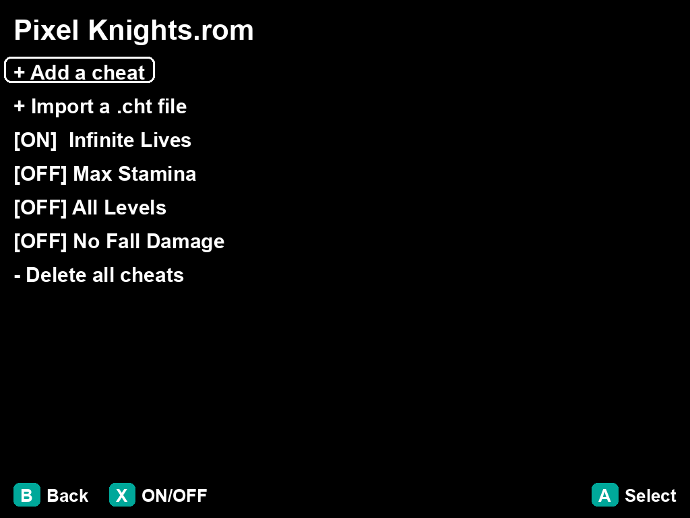
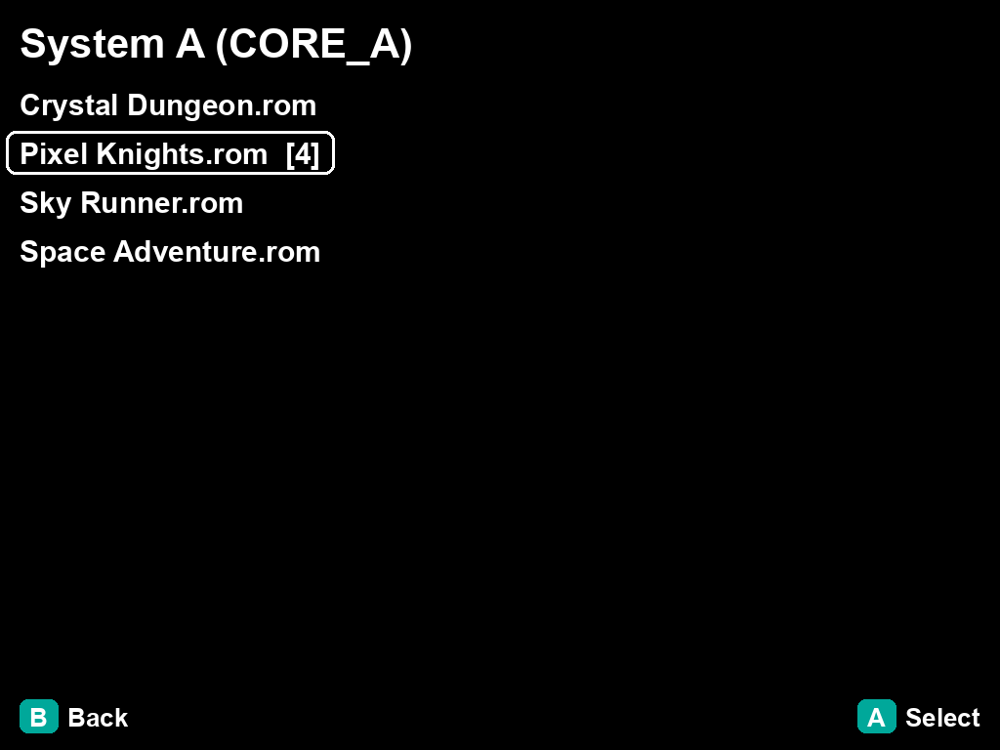
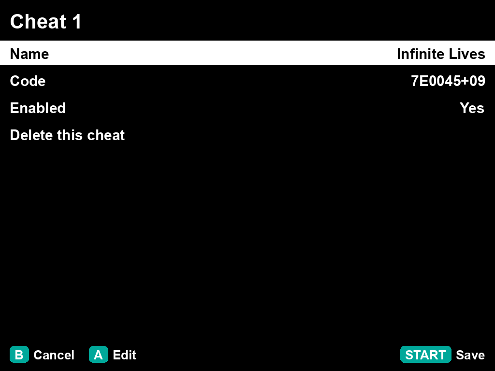
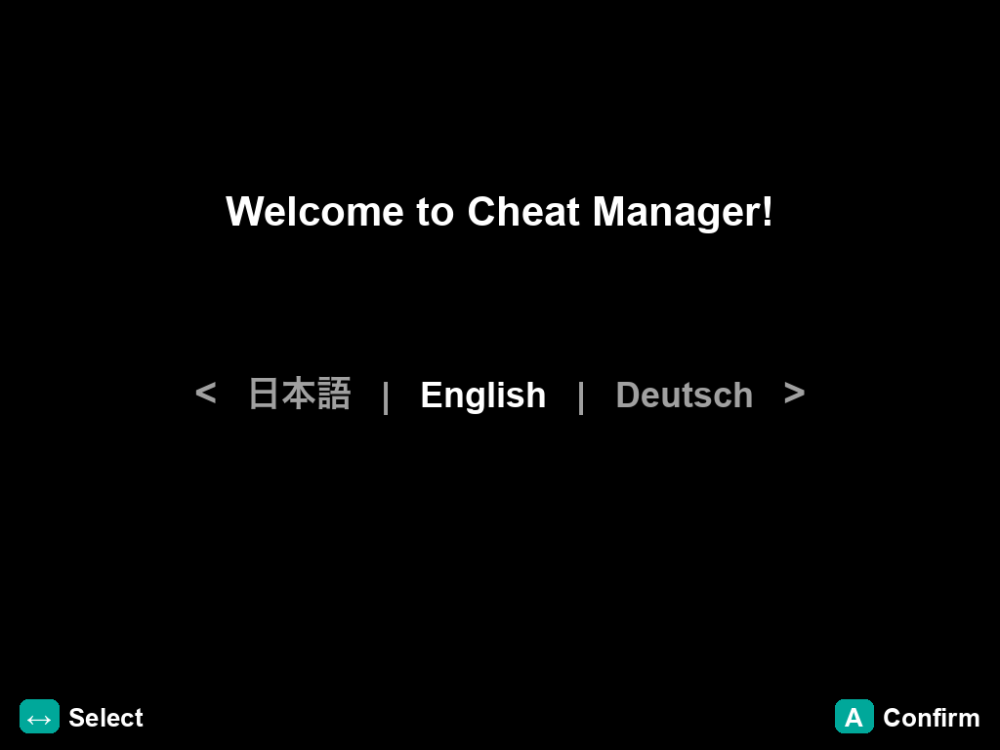

# Cheat Manager for NextUI

Cheat Manager is a [NextUI](https://github.com/LoveRetro/NextUI) tool for managing RetroArch cheats (`.cht` files) directly on your TrimUI Brick or TrimUI Smart Pro. No computer is needed.



## Features

- Browse your systems and games. The number of existing cheats is shown next to each game.
- **Add** a cheat (name + code) with the on-screen keyboard.
- **Edit** the name or code of a cheat, **enable/disable** it (also from the list with **X**), and **delete** it.
- **Import** any `.cht` file found under `/Cheats`, such as one from the libretro cheat database. You can add its cheats to the existing ones or replace them.
- **Delete all** the cheats of a game.
- Safe writes: the previous version of a file is always kept as `<file>.cht.bak`.
- Unknown RetroArch keys (`cheatN_handler`, `cheatN_address`, ...) are preserved.
- Available in 7 languages: English, Deutsch, Español, Français, Italiano, Português and 日本語. The language is chosen on first launch and can be changed later with **Y**.

| Games | Edit a cheat | Language |
|---|---|---|
|  |  |  |

## Installation

### From the Pak Store

Open **Pak Store** on your device and install **Cheat Manager**.

### Manually

1. Download `Cheat.Manager.pak.zip` from the [latest release](https://github.com/tfournier/nextui-cheat-manager/releases/latest).
2. Unzip the archive into `/Tools/tg5040/` on your SD card. You should get `/Tools/tg5040/Cheat Manager.pak/launch.sh`.
3. Open **Tools > Cheat Manager** on your device.

## Usage

| Screen | Buttons |
|---|---|
| Lists | **A** select · **B** back · **X** toggle the selected cheat · **Y** change language (home screen) |
| Cheat form | **A** edit the field · **Left/Right** change *Enabled* · **START** save · **B** cancel |
| Keyboard | **START** confirm · **Y** cancel |

When several codes make up one cheat, separate them with `+`. In a game, cheats are available in **Menu > Options > Cheats**.

### Where are the files?

Cheat Manager follows the NextUI convention: the cheat file of a ROM is named after the ROM file, extension included, in the folder named after the system tag.

```
/Roms/System A (CORE_A)/Pixel Knights.rom   ->   /Cheats/CORE_A/Pixel Knights.rom.cht
```

| File | Location |
|---|---|
| Settings (language) | `/.userdata/tg5040/Cheat Manager/settings.json` |
| Logs | `/.userdata/tg5040/logs/Cheat Manager.txt` and `Cheat Manager.stderr.txt` |

## Development

The UI uses [gabagool](https://github.com/BrandonKowalski/gabagool), the Go UI library used by the Pak Store and Grout.

```
.
├── main.go                 UI screens
├── internal/cheats         .cht parsing/writing and ROM listing (pure Go)
├── internal/l10n           translations (messages.go + locales/*.toml)
├── internal/settings       user settings
├── pak/                    launch.sh and files shipped in the pak
├── scripts/                toolchain setup
└── pak.json                Pak Store metadata (version, changelog...)
```

### Build

The binary is cross-compiled for ARM64 against Debian 11 (bullseye) libraries, which is old enough for the TrimUI firmware. The easiest way to build is with Docker:

```sh
make docker-release      # builds dist/Cheat.Manager.pak.zip
```

Other targets (`make help`):

| Target | Description |
|---|---|
| `make test` | Unit tests. Pure Go, so no toolchain is needed. |
| `make lint` | Runs `gofmt` and `go vet`. |
| `make build` / `pak` / `release` | Cross-compile, assemble the pak, build the zip. These need the toolchain from `scripts/setup-toolchain.sh`. |
| `make docker-<target>` | Run any target inside the build image. |
| `make vX.Y.Z` | Release a version (see [Releasing](#releasing)). |

### Run on a computer

The UI can run on a desktop for development (keyboard: arrows, `a`, `b`, `x`, `y`, `Return` = START):

```sh
CHEATS_DESKTOP=1 FALLBACK_FONT=/path/to/font.ttf SDCARD_PATH=/path/to/fake/sdcard go run -tags nodefaultfont .
```

This requires SDL2, SDL2_ttf, SDL2_image and SDL2_gfx development packages.

### Translations

Messages are declared once, in English, in `internal/l10n/messages.go`. Each language has a file in `internal/l10n/locales/active.<lang>.toml`. To add or fix a translation:

1. Edit or create `active.<lang>.toml`. Keep the same keys and the same `{{.Variables}}` as English.
2. For a new language, add it to `Languages` in `internal/l10n/l10n.go`.
3. Run `make test`. The tests check that every language has every message, with the same variables.

## Releasing

`pak.json` is the single source of the version and of the changelog. The Pak Store shows the changelog, and the GitHub release uses it as release notes.

1. Add or update the `"Unreleased"` entry in the `changelog` of `pak.json`, and commit it like any other change. The entry is plain text, and `\n` starts a new line:

   ```json
   "changelog": {
     "Unreleased": "Fixed:\n- Import of large .cht files",
     ...
   ```

2. From an up-to-date `main` branch with no uncommitted changes, run:

   ```sh
   make v1.2.3
   ```

   This runs the lint and the tests, renames `Unreleased` to `v1.2.3` in `pak.json`, sets `version`, commits as `Release v1.2.3`, tags `v1.2.3` and pushes both.

The [CI workflow](.github/workflows/ci.yml) then builds the pak and publishes the GitHub release with `Cheat.Manager.pak.zip`.

### Pak Store

The Pak Store reads `pak.json` from this repository and downloads `<repo_url>/releases/download/<version>/<release_filename>`. That is why the tag, the `pak.json` version and the release file name must match, and why the CI checks it. To get listed, use the [Pak Store submission form](https://github.com/LoveRetro/nextui-pak-store/issues/new?template=new-pak-submission.yml).

## AI Disclosure

This project was entirely written by AI ([Claude](https://claude.ai) by Anthropic), including the code, tests, translations, documentation and CI pipeline.

## License

[MIT](LICENSE). Third-party components are listed in [pak/THIRD_PARTY.md](pak/THIRD_PARTY.md).
